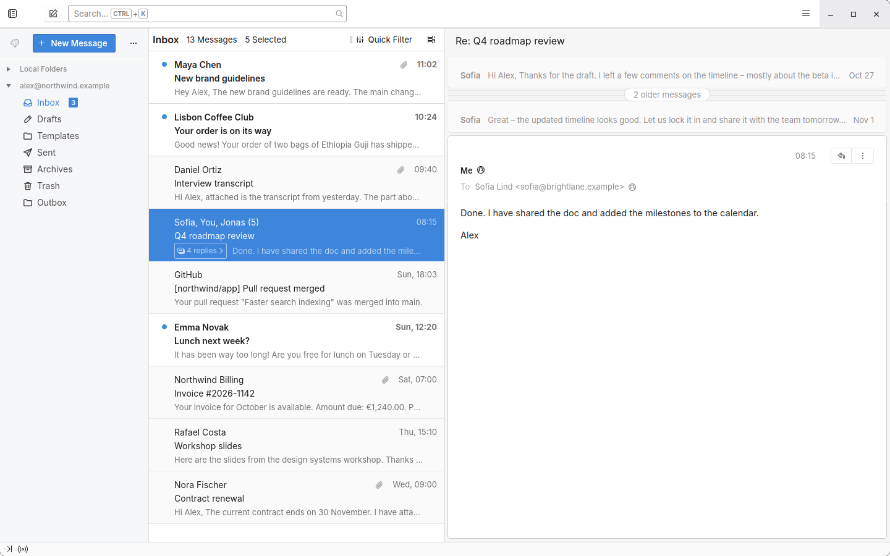
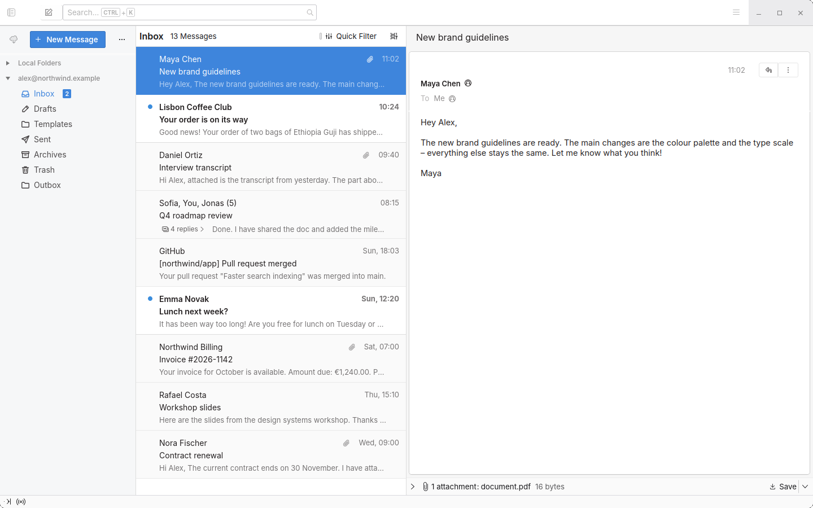

# Calm for Thunderbird

A light, calm theme for Thunderbird – with message previews, conversation threads and optional open tracking.





## What's included

- **Theme** – cleaner folder pane, message list, reading pane, compose window and menus.
- **Preview for Thunderbird** – a preview line under each subject, and threads shown as one conversation.
- **Tracking for Thunderbird** *(optional)* – see when your sent emails are opened, using your own server.

## Requirements

- Thunderbird 128 or newer (tested on 153 ESR), on Linux
- A Thunderbird build that allows unsigned add-ons (e.g. the Ubuntu/Mint package). Otherwise set `xpinstall.signatures.required` to `false` in the Config Editor.
- `git`, `zip` and the [Inter](https://rsms.me/inter/) font (`sudo apt install fonts-inter`)

## Install

```bash
git clone https://github.com/trailblazestudio/thunderbird-kit.git
cd thunderbird-kit
./install.sh        # close Thunderbird first
```

Then open Thunderbird → **Add-ons and Themes** → ⚙ → **Install Add-on From File** and pick the files in `dist/`.

To update an add-on, remove the old version first. To remove the theme, delete `userChrome.css` and `userContent.css` from the `chrome` folder in your profile.

## Tracking (optional)

Tracking adds an invisible image to each email you send. When the recipient's mail app loads it, your server records an open, and Thunderbird shows an eye icon and "N opens" on the message. You can turn it off per email with the eye button in the compose window.

It needs a small server. It runs for free on Cloudflare Workers and needs a [Cloudflare account](https://dash.cloudflare.com/sign-up) and Node.js.

### 1. Choose a domain

The pixel's address is part of every email you send and **can't be changed later** without breaking tracking for emails already sent. Pick one:

| Option | Cost | Notes |
|---|---|---|
| `img.<subdomain>.workers.dev` | Free | Works right away. Shared domain, so a few corporate filters block it more often. Set a neutral subdomain first under *Workers & Pages → Account details → Subdomain*. |
| `img.yourdomain.com` | Free | Your own domain on Cloudflare. Clean reputation, but recipients can see it's yours. |
| A new, neutral domain | ~$10/year | Neutral and under your control. |

Avoid words like `track` or `pixel` in the address – they are on blocklists.

### 2. Deploy the server

```bash
cd server
npm install -g wrangler
wrangler login
wrangler d1 create tracking                  # note the database_id
cp wrangler.toml.example wrangler.toml       # paste the database_id (and your domain, if any)
wrangler d1 execute tracking --remote --file=schema.sql
openssl rand -hex 20 > ../api-key.txt
wrangler secret put API_KEY < ../api-key.txt
wrangler deploy
```

### 3. Build the add-on

```bash
cp addons/tracking/config.example.js addons/tracking/config.js
# edit config.js: your server URL and the key from api-key.txt
./build.sh
```

Install `dist/tracking-for-thunderbird.xpi`. It contains your key, so don't share it.

### Good to know

- Your own views in Thunderbird never count as opens.
- Automatic fetches (spam filters, Apple Mail Privacy Protection) are not counted.
- With several recipients, you can't tell which one opened the email.
- The server stores the time, city/country and mail app of each open – no IP addresses.
- In the EU, tracking pixels may require the recipient's consent (ePrivacy/GDPR). Using it lawfully is your responsibility.

## License

[MIT](LICENSE)
